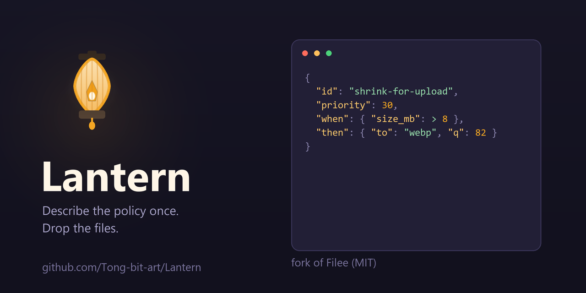

<p align="center">
  
</p>

<h1 align="center">Lantern</h1>

<p align="center">
  <b>Write down how a batch should be handled, once.</b><br>
  A 280-format offline file converter with a declarative policy engine.
</p>

<p align="center">
  
  
  
  
  
  
  <a href="https://github.com/Tong-bit-art/Lantern/releases/latest"></a>
  
</p>

<p align="center">
  <a href="#build"><b>Build</b></a> ·
  <a href="#the-policy-file">policy.json</a> ·
  <a href="FORK-CHANGES.md">Fork changes</a> ·
  <a href="docs/UPSTREAM.md">Upstream tracking</a> ·
  <a href="ROADMAP.md">Roadmap</a> ·
  <a href="CONTRIBUTING.md">Contributing</a> ·
  <a href="SUPPORT.md">Support</a>
</p>

> [!IMPORTANT]
> **Lantern is a fork of [Filee](https://github.com/KnifeLemon/Filee) (MIT).** All format conversion
> is upstream's work. What is new here is the declarative policy layer, its tests, and the installer
> identity split that lets the two coexist. [`FORK-CHANGES.md`](FORK-CHANGES.md) itemises every
> change and [`NOTICE`](NOTICE) records the derivation. Problems that a stock Filee would also have
> belong in [Filee's tracker](https://github.com/KnifeLemon/Filee/issues), not here.

> [!NOTE]
> **Source only — `v1.0.0` is tagged and published, but there is no binary to download.** Build from source. There
> is no code-signing certificate and no update signing key, so SmartScreen will warn about an
> installer you build and the auto-updater is inert. Stated up front rather than buried.

## Contents

- [Why the rules layer exists](#why-the-rules-layer-exists)
- [The policy file](#the-policy-file) — [conflict resolution](#how-conflicts-are-settled) · [facts](#facts-you-can-test) · [operators](#operators)
- [What you get from upstream](#what-you-get-from-upstream-unchanged)
- [Build](#build)
- [How this repo relates to Filee](#how-this-repo-relates-to-filee)
- [What is not provisioned](#what-is-not-provisioned)
- [Licence](#licence)

---

## Why the rules layer exists

A converter normally decides *what a file becomes*. It does not decide *how a whole batch should
be treated*. Those are different problems, and the second one is where batch work actually hurts.

Four things the preset model cannot express, and this fork does:

**Per-file-type defaults in one pass.** Your camera writes HEIC and your screenshot tool writes
PNG. You want the first kept at quality 92 and the second crushed to WEBP at 82. Without rules
that is two selections, two drags, every single time.

**Decisions that depend on the size of the drop.** "If this drop contains more than a dozen office
documents, they are a paperwork stack — merge them into one PDF instead of converting twelve
separate files." A preset sees one file and has no idea how many siblings it has. A rule sees
`request.batch_count`.

**An answer to "why did it do that".** When a file comes out in a format you did not expect,
something has to tell you which setting won. Every decision here produces a line-by-line account:
which rules matched, what each test compared, which value survived.

**Guard rails that cannot be overridden by accident.** A batch tool's worst failure mode is
overwriting originals. The shipped policy refuses any conversion whose output would land on its own
source, and the rule is *sealed* — a rule you add later, even at priority 99999, cannot outrank it.

## The policy file

Rules live in `policy.json` in the app's data directory. The default is the platform's
application-data folder plus `Lantern` (`%APPDATA%\Lantern` on Windows; on Linux and macOS it
follows `Environment.SpecialFolder.ApplicationData`, which resolves to `$XDG_CONFIG_HOME/Lantern`
or `~/.config/Lantern`). Setting the `LANTERN_DATA_DIR` environment variable overrides it, which is
also how a development copy keeps its policy separate from the one you actually run.

```jsonc
{
  "name": "default",
  "rules": [
    {
      "id": "photo-quality",
      "description": "Camera originals keep their quality",
      "priority": 50,
      "when": {
        "tests": [
          { "fact": "source.extension", "operator": "inset",
            "operand": ["heic", "dng", "cr2", "cr3", "nef", "arw"] }
        ]
      },
      "then": { "targetFormat": "jpg", "quality": 92 }
    },
    {
      "id": "merge-paperwork",
      "description": "A dozen documents is a stack, not a pile",
      "priority": 40,
      "when": {
        "tests": [
          { "fact": "source.extension", "operator": "inset",
            "operand": ["docx", "doc", "odt", "rtf", "xlsx", "pptx", "pdf"] },
          { "fact": "request.batch_count", "operator": "gte", "operand": 12 }
        ]
      },
      "then": { "presetId": "merge-pdf", "namePattern": "{folder}-merged" }
    }
  ]
}
```

### What a rule can decide, and what it cannot

A rule is evaluated once per drop, before the job is queued, and its decision applies to the whole
job. That is deliberate: a `ConversionJob` carries one preset for all its files, and the case that
actually needs rules — *"this drop is twelve documents, merge it"* — is a statement about the drop,
not about a file.

Per-file rules (converting a mixed drop with different settings for each kind) need the job model to
hold a preset per file. That is the next piece of work, tracked in [ROADMAP.md](ROADMAP.md) rather
than described here as if it worked.

A rule can change the preset (target format, quality, longest edge), set the output folder and file-name
pattern, name a different preset outright, or refuse the job. It cannot see inside a file: anything
that needs the file opened belongs to the engine.

`allowedEngines` is parsed, merged and shown in the decision trace, but **not enforced yet** — the
route planner has no per-job allow-list. `ConversionPolicy.UnsupportedActionFields` names it so a user
is told rather than quietly ignored; see [ROADMAP.md](ROADMAP.md).

### How conflicts are settled

Three rules, applied in order:

1. **Priority** — a higher number overwrites a lower one.
2. **Specificity** — at equal priority, the rule carrying more tests wins. This is why a general
   rule can sit at the top of the file and the exceptions below it, instead of every rule needing
   a hand-maintained unique priority integer.
3. **Declaration order** — later in the file wins what is still tied.

Rules **layer** rather than replace. A rule contributes only the fields it names; everything else
survives from lower-ranked rules. `allowedEngines` intersects instead of overwriting, so two rules
that each permit a set of engines end up permitting only what both allow — adding a restrictive
rule can never widen what a stricter one forbade.

A rule can set `"sealed": true` to become immune to anything lower, regardless of priority.

### Facts you can test

| Fact | Type | Meaning |
| --- | --- | --- |
| `source.name` | text | File name with extension |
| `source.extension` | text | Lowercased extension, derived automatically |
| `source.size_bytes` | number | Exact size |
| `source.size_mb` | number | Size in MB, derived automatically |
| `source.category` | text | Format family: `image`, `pdf`, `document`, `video`, … |
| `source.format` | text | Format id |
| `request.preset` | text | Preset the caller invoked |
| `request.target` | text | Requested target format |
| `request.batch_count` | number | How many files are in this drop |
| `destination.folder` | text | Where the output would go |
| `destination.free_mb` | number | Free space at the destination |
| `destination.would_overwrite_source` | boolean | Set by the caller before evaluation |
| `user.language` | text | UI language code |
| `user.tag` | text | Free-form tag the caller supplies |

### Operators

`equals` · `notequals` · `gt` · `gte` · `lt` · `lte` · `contains` · `startswith` · `endswith` ·
`inset` · `matches` (regex, 100 ms timeout) · `exists` · `notexists`

Conditions nest, and combine with `all`, `any`, `none`, or `atleast` (with a `minimum`).

A comparison between incompatible types **fails and says so in the trace** rather than coercing.
That strictness is deliberate: rule engines that coerce are why people stop trusting rule engines.

### When the file is wrong

The reader is lenient on purpose, because this file gets hand-edited:

- An unknown operator drops that one test, not the rule.
- A rule with no `id` is skipped with a warning, not fatal.
- Corrupt JSON falls back to the starter policy instead of taking the whole app down.

None of that can silently disable the system. That is the point.

## What you get from upstream, unchanged

All of the actual conversion work: 280 recognised formats across images, PDF, Office documents,
HWP/HWPX, e-books, video, audio, subtitles, archives, vector graphics, CAD, fonts, 3D models and
geospatial data. 169 built-in presets. 22 interface languages. A radial menu that opens at your
cursor. Watch folders. A command line.

Switchable format fields mean a user who never touches CAD or 3D models does not see those slices,
while the formats still convert if a file of that kind arrives — "off" hides, it does not disable.

The full capability list is upstream's to document accurately, so it is not restated here at
length. See [Filee's README](https://github.com/KnifeLemon/Filee) for the format matrix and the
engine download behaviour.

## Releasing

[`docs/RELEASING.md`](docs/RELEASING.md) covers the tag, the release notes and what is still missing
before a binary release is possible. The short version: source only, because there is no code-signing
certificate and no update signing key, and three CI jobs need artifacts this fork does not yet host.

## Build

.NET 10 SDK required.

```bash
git clone https://github.com/Tong-bit-art/Lantern.git
cd Lantern
dotnet build Lantern.slnx -c Release
dotnet run --project src/Lantern.App
```

Tests, and what to expect from them:

```bash
dotnet test Lantern.slnx
```

`WebDownloaderTests` contains two cases that resolve real DNS names and make real HTTP requests.
Both fail in a restricted network, and both fail identically on the unmodified upstream checkout —
they are environment-dependent, not a regression. Everything else passes. The recorded run is in
[`EVIDENCE/build-log.txt`](EVIDENCE/build-log.txt).

Optional engines (FFmpeg, LibreOffice, calibre, Ghostscript, Pandoc, ExifTool, Tesseract) download
on first use. Bundled binaries:

```bash
pwsh build/fetch-engines.ps1
```

## How this repo relates to Filee

Lantern is MIT-licensed and derived from Filee, also MIT. The `LICENSE` file carries **both**
copyright lines, which is what the licence requires and what honesty requires.

| File | What it establishes |
| --- | --- |
| [`UPSTREAM-BASELINE.txt`](UPSTREAM-BASELINE.txt) | The exact upstream commit, so the diff is reproducible |
| [`FORK-CHANGES.md`](FORK-CHANGES.md) | Every change, split into mechanical renames, identity replacements, and original work |
| [`EVIDENCE/ARCHITECTURE-REPORT.md`](EVIDENCE/ARCHITECTURE-REPORT.md) | How the system is built: routing graph, format model, identity surfaces |
| [`EVIDENCE/ORIGINALITY.md`](EVIDENCE/ORIGINALITY.md) | Precisely what is original here, with the commands to verify it |
| [`NOTICE`](NOTICE) | Derivation statement and trademark position |

Being blunt about it: **most of this repository is not my code.** The policy engine, its 27 tests
and the documentation are. Section 3 of `FORK-CHANGES.md` draws that line and the verification
commands in `ORIGINALITY.md` let you check whether it holds.

### Installer identity was changed on purpose

This fork cannot coexist with a Filee installation if it keeps upstream's identity. Specifically:

- New installer GUID (`{891211E8-…}` instead of `{C8686E06-…}`). The old one would have registered
  this as an upgrade of Filee, overwriting it and deleting its files on uninstall.
- Separate registry keys, data directories, cache folders and single-instance mutex.
- Upstream's update signing key and expected Authenticode publisher/issuer are **emptied, not
  replaced**. Those values gate update acceptance; left populated, the app would report an update
  as available and then refuse it forever, because the matching private key belongs to the
  upstream maintainer.

### What is not provisioned

- No code-signing certificate. Windows installers built from this tree will trigger SmartScreen.
- No update signing key. The updater falls back to same-release checksum verification.
- No published release. CI runs, but the workflow inherited from upstream has not yet passed on this
  repository, which is why there is no status badge on this page.

Populating either requires generating a key pair with `build/new-update-key.ps1` and buying an
Authenticode certificate.

## Code signing policy

**Nothing published so far is signed**, because there is nothing published. When a release exists:

- Windows binaries will be signed with an Authenticode certificate issued to Tong-bit-art.
- Every release will carry a `SHA256SUMS` file; the updater verifies it against the key embedded at
  build time (`FileeUpdatePublicKey` in `Directory.Build.props`, empty today).
- An update whose signature does not verify is refused on every platform.

Until those are provisioned, the updater accepts only a same-release checksum match, and an
installer you build yourself is unsigned by definition. That is the honest state of it.

## Privacy policy

Lantern converts files on your own computer and never uploads them. It collects no usage data and
sends no telemetry. It makes network requests only to:

- Ask GitHub (`api.github.com`) whether a newer release exists, shortly after start and then every
  few hours. Turn this off in Settings → About.
- Download the optional conversion engines you choose to install, from the official locations
  pinned in `engines.json`, and the OCR language data a preset uses, pinned in `ocr-languages.json`.
- Open a link, when you click one. That opens your browser.

The policy engine does no I/O at all: it evaluates a fact table in memory.

## Licence

MIT. Third-party components keep their own terms — see
[`THIRD-PARTY-NOTICES.md`](THIRD-PARTY-NOTICES.md).

"Filee" is the upstream project's name. This fork does not use its name, logo, website, installer
identity, update key or signing certificate.

## Links

- Upstream project: [KnifeLemon/Filee](https://github.com/KnifeLemon/Filee)
- This fork: [Tong-bit-art/Lantern](https://github.com/Tong-bit-art/Lantern)

## Thanks

To Myeonggu Kim (KnifeLemon) and the Filee contributors, whose MIT-licensed work this builds on.

<!-- sponsors: src/Lantern.App/Assets/Sponsors/sponsors.json -->
